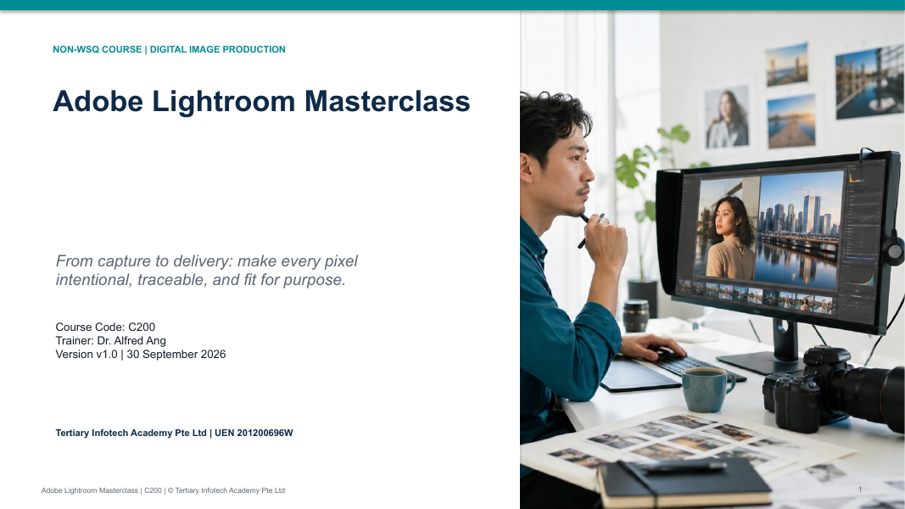

# Adobe Lightroom Masterclass

A hands-on, one-day Lightroom course that takes you from stakeholder brief and ingest to non-destructive global and local editing, review, export and archive.

| Course detail | Information |
|---|---|
| Course code | `C200` |
| Programme | Non-WSQ |
| Duration | 1 day · 7.5 instructional hours (9:30am – 5:30pm) |
| Registration | [View course details and register](https://www.tertiarycourses.com.sg/adobe-lightroom-masterclass.html) |



## About the course

Lightroom is a non-destructive production system, not a set of sliders. This course treats every edit as a reversible, explainable decision: you translate a stakeholder brief into observable image criteria, build a colour-aware workspace, cull and organise a library, apply tone, colour, geometry, detail, masking, retouching and AI-assisted enhancement with human quality control, and deliver a traceable, rights-checked campaign set. Seven realistic Singapore workplace scenarios run through the day.

## Learning outcomes

By the end of the course you will be able to:

- Explore ideas and techniques of digital imagery with stakeholders and improve production techniques through practice and experimentation.
- Evaluate digital-imaging capabilities against theoretical contexts and principles of design.
- Discuss and document the digital-image production process with others while applying intellectual-property considerations.

## Topics covered

1. **Get Started on Digital Imagery Techniques Using Lightroom** — the Lightroom ecosystem, colour-aware workspace, creative briefs, file decisions, ingest, culling, organising and version experiments.
2. **Evaluate Digital Imaging Capabilities Using Lightroom** — reading the image, design principles, histogram and tone curve, white balance and colour, geometry, detail and noise, presets, masking, retouching, Generative Remove and AI enhancement, HDR and panorama merges.
3. **Process of Digital Image Production** — stakeholder review, shared albums, copyright, licence and consent, AI provenance, destination-specific export, quality assurance and archiving.

## Activities

Each activity folder holds authorised source images, a scenario and role briefs, a detailed click-by-click workflow, a worksheet and an acceptance checklist, in Markdown and PDF. Start from the [activities index](activities/README.md).

| # | Activity | Topic |
|---|---|---|
| 01 | [Stakeholder Brief and Colour-Safe Workspace](activities/Activity-01-stakeholder-brief-and-colour-safe-workspace/README.md) | 1 |
| 02 | [Marina Bay Event Library: Cull, Organise, and Retrieve](activities/Activity-02-marina-bay-event-library-cull-organise-and-retrieve/README.md) | 1 |
| 03 | [Artisan Bakery Product Series: Tone, Colour, and Consistency](activities/Activity-03-artisan-bakery-product-series-tone-colour-and-consistency/README.md) | 2 |
| 04 | [Heritage Hotel Interior: Composition, Geometry, and Local Light](activities/Activity-04-heritage-hotel-interior-composition-geometry-and-local-light/README.md) | 2 |
| 05 | [Community Portrait Campaign: Natural Masking and Retouching](activities/Activity-05-community-portrait-campaign-natural-masking-and-retouching/README.md) | 2 |
| 06 | [Tourism Image Rescue: Detail, Removal, and AI Enhancement](activities/Activity-06-tourism-image-rescue-detail-removal-and-ai-enhancement/README.md) | 2 |
| 07 | [Capstone: Northstar Retail Campaign Review and Delivery](activities/Activity-07-capstone-northstar-retail-campaign-review-and-delivery/README.md) | 3 |

## Courseware package

| Material | Editable | PDF |
|---|---|---|
| Trainer slide deck (v1.0, 132 slides) | [PPTX](courseware/Adobe%20Lightroom%20Masterclass-v1.0.pptx) | [PDF](courseware/Adobe%20Lightroom%20Masterclass-v1.0.pdf) |
| Lesson Plan | [DOCX](courseware/LP-Adobe%20Lightroom%20Masterclass.docx) | [PDF](courseware/LP-Adobe%20Lightroom%20Masterclass.pdf) |
| Learner Guide | [DOCX](courseware/LG-Adobe%20Lightroom%20Masterclass.docx) | [PDF](courseware/LG-Adobe%20Lightroom%20Masterclass.pdf) |
| Learner Guide (Markdown) | [LG-Adobe Lightroom Masterclass.md](LG-Adobe%20Lightroom%20Masterclass.md) | — |

```text
.
├── courseware/        slide deck, Lesson Plan and Learner Guide (editable + PDF)
├── activities/        seven self-contained activity packs
├── LG-Adobe Lightroom Masterclass.md
└── courseware-cover.png
```

Clone the activities with:

```bash
git clone https://github.com/tertiarycourses/C200-Adobe-Lightroom-Masterclass.git
```

## Distribution

This repository publishes the learner-facing courseware and activity packs. Trainer-only source references are kept in controlled storage and are not part of this repository. Keep supplied source images unchanged and save your edits in a separate `evidence/` folder inside each activity.

## Provider

Developed and delivered by **[Tertiary Infotech Academy Pte Ltd](https://www.tertiarycourses.com.sg/)** (UEN 201200696W). Third-party product names and source materials remain subject to their respective rights and licences.
